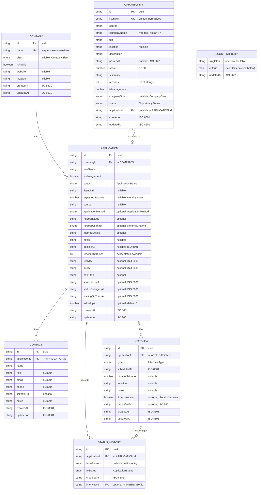
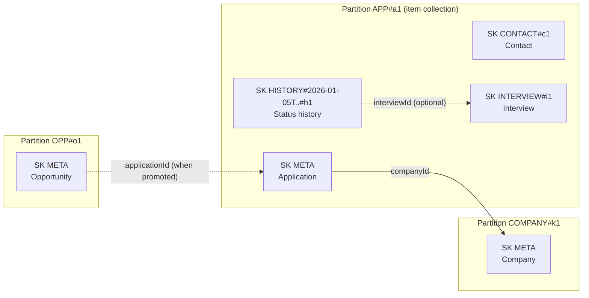

# Data model

The app stores everything in **one DynamoDB table** (single-table design). There are no foreign-key constraints in the database: relationships are encoded in the keys (`PK`/`SK`) and enforced by the repositories. This document shows the model twice:

1. [Logical model](#1-logical-model-erd): what the entities are and how they relate (the ERD).
2. [Physical model](#2-physical-model-the-table): how those entities are laid out as items, keys and indexes.

For the surrounding design decisions see [ARCHITECTURE.md](ARCHITECTURE.md#4-data-layer). Source of truth in code: item types in `apps/api/src/db/mappers.ts`, key builders in `apps/api/src/db/dynamo.ts`, table definition in `apps/api/src/db/table.ts` (mirrored by `infra/modules/dynamodb`), enums in `packages/shared/src/enums.ts` and `scout.ts`.

## 1. Logical model (ERD)

### Relationships

| Relationship                  | Cardinality | Kind                                   | Notes                                                                                                                                         |
| ----------------------------- | ----------- | -------------------------------------- | --------------------------------------------------------------------------------------------------------------------------------------------- |
| Company → Application         | 1 : many    | `APPLICATION.companyId` → `COMPANY.id` | An application always has a company. Companies are created implicitly with an application and de-duplicated by lowercased name.               |
| Application → Contact         | 1 : many    | `CONTACT.applicationId`                | Child rows live in the application's partition; deleting the application deletes them.                                                        |
| Application → Interview       | 1 : many    | `INTERVIEW.applicationId`              | Same partition as the application.                                                                                                            |
| Application → Status history  | 1 : many    | `STATUS_HISTORY.applicationId`         | Append-only log of status changes; same partition, sorted by time.                                                                            |
| Interview → Status history    | 1 : 0..many | `STATUS_HISTORY.interviewId` (optional) | Set when a history step was created by, or came from, an interview. Absent on older rows.                                                     |
| Opportunity → Application     | many : 0..1 | `OPPORTUNITY.applicationId` (nullable) | Set when a suggestion is promoted (`status = promoted`). Reverse lookup (application → opportunity) is served by GSI2.                         |
| Scout criteria                | singleton   | none                                   | One item for the whole table (single user). Not related to other entities; it drives which opportunities the scout worker keeps.             |

Not stored: the **action queue** (what needs doing today) is derived from applications and interviews by `deriveActions` in `packages/shared/src/actions`, and **gamification progress** is derived by `build-progress.ts`. Neither has items in the table.

### Enumerations

| Enum                | Values                                                                                                                                                                 |
| ------------------- | ---------------------------------------------------------------------------------------------------------------------------------------------------------------------- |
| `ApplicationStatus` | `to_apply`, `applied`, `hr_screening`, `phone_interview`, `technical_interview`, `home_assignment`, `onsite_interview`, `final_interview`, `offer`, `accepted`, `rejected`, `withdrawn`, `ghosted` |
| Closed statuses     | `accepted`, `rejected`, `withdrawn`, `ghosted` (everything else is "active")                                                                                           |
| `CompanySize`       | `early_stage_startup`, `startup`, `unicorn`, `corporate`                                                                                                               |
| `InterviewType`     | `hr`, `phone`, `technical`, `system_design`, `home_assignment`, `home_assignment_review`, `onsite`, `managerial`, `final`, `coffee`, `other`                            |
| `ApplicationMethod` | `referral`, `linkedin`, `company_site`, `job_board`, `recruiter_outreach`, `networking_event`, `other`                                                                 |
| `ReferralChannel`   | `in_person`, `phone`, `whatsapp`, `linkedin`, `email`, `other`                                                                                                         |
| `OpportunityStatus` | `new`, `filtered`, `dismissed`, `promoted`                                                                                                                             |

### Scout criteria payload

Stored as a JSON map in the `criteria` attribute and re-parsed with `ScoutCriteriaSchema` on read, so criteria saved before a field existed pick up its default.

| Field              | Type                                            | Default  |
| ------------------ | ----------------------------------------------- | -------- |
| `roles`            | list of string (trimmed, de-duplicated)         | `[]`     |
| `seniorities`      | list of `SeniorityLevel`                        | `[]`     |
| `track`            | `ic` \| `management` \| `either`                | `either` |
| `locations`        | list of string                                  | `[]`     |
| `companySizes`     | list of `CompanySize` (empty = any)             | `[]`     |
| `excludedCompanies`| list of string (case-insensitive match)         | `[]`     |
| `minScore`         | integer 0–100                                   | `60`     |

## 2. Physical model (the table)

One table, composite primary key, two global secondary indexes, on-demand billing, point-in-time recovery on AWS.

| Attribute           | Type | Role                                  |
| ------------------- | ---- | ------------------------------------- |
| `PK`                | S    | Table partition (hash) key            |
| `SK`                | S    | Table sort (range) key                |
| `GSI1PK` / `GSI1SK` | S    | `GSI1` partition / sort key, `ALL` projection |
| `GSI2PK` / `GSI2SK` | S    | `GSI2` partition / sort key, `ALL` projection |

All other attributes are schemaless; the columns and types are those in the ERD above. Dates are ISO 8601 strings (which sort chronologically as text), booleans are native, optional fields are either absent (rows written before the field existed) or explicit `null`.

### Item layout

| Entity                | PK                   | SK                   | GSI1PK / GSI1SK                                         | GSI2PK / GSI2SK                              |
| --------------------- | -------------------- | -------------------- | ------------------------------------------------------- | -------------------------------------------- |
| Company               | `COMPANY#<id>`       | `META`               | `COMPANIES` / `<lowercased name>#<id>`                  |                                              |
| Company-name marker   | `CNAME#<lowercased>` | `META`               |                                                         |                                              |
| Application           | `APP#<id>`           | `META`               | `APPS` / `<updatedAt>#<id>`                             |                                              |
| Contact               | `APP#<appId>`        | `CONTACT#<id>`       |                                                         |                                              |
| Interview             | `APP#<appId>`        | `INTERVIEW#<id>`     | `INTERVIEWS` / `<scheduledAt>#<id>`                     |                                              |
| Status history entry  | `APP#<appId>`        | `HISTORY#<at>#<id>`  |                                                         |                                              |
| Opportunity           | `OPP#<id>`           | `META`               | `OPPSTATUS#<status>` / `<score, 5 digits>#<createdAt>#<id>` | `APPOPP#<applicationId>` / `<opportunityId>` (only once promoted) |
| Listing-URL marker    | `OPPURL#<sha256(url)>` | `META`               |                                                         |                                              |
| Scout criteria        | `SCOUT`              | `CRITERIA`           |                                                         |                                              |

Marker items exist only to enforce uniqueness (they carry no data). They are written in the same transaction as their entity with `attribute_not_exists`, which gives the equivalent of `UNIQUE(company.name)` and `UNIQUE(opportunity.listingUrl)`.

### How the relationships map onto keys

- **One-to-many inside the application aggregate** is expressed by sharing `PK = APP#<id>` and using a typed `SK` prefix (`CONTACT#`, `INTERVIEW#`, `HISTORY#`). One `Query` on the partition loads the application with all its children; `begins_with(SK, 'CONTACT#')` loads one kind.
- **Many-to-one across aggregates** (application → company, opportunity → application) is a plain attribute holding the other item's id, resolved with a `GetItem`/`BatchGetItem` on its key.
- **History ordering:** the timestamp is embedded in the sort key, so history comes back in chronological order for free.

### Access patterns and the key that serves them

| Access pattern                                   | Operation                                                                    |
| ------------------------------------------------ | ---------------------------------------------------------------------------- |
| Get one application with contacts, interviews, history | `Query PK = APP#<id>`                                                  |
| List applications, newest updated first         | `Query GSI1 GSI1PK = APPS`, descending                                       |
| Upcoming interviews / next interview per application | `Query GSI1 GSI1PK = INTERVIEWS`, `GSI1SK > <now>`                      |
| List or search companies                         | `Query GSI1 GSI1PK = COMPANIES` (name search filtered in memory)             |
| Does a company with this name exist              | `GetItem CNAME#<lowercased> / META`                                          |
| List suggestions by status, best score first     | `Query GSI1 GSI1PK = OPPSTATUS#<status>`, descending                         |
| Has this listing already been suggested          | `GetItem OPPURL#<sha256(url)> / META`                                                |
| Which opportunity became this application        | `Query GSI2 GSI2PK = APPOPP#<applicationId>`                                 |
| Scout criteria                                   | `GetItem SCOUT / CRITERIA`                                                   |

Updating an application's `updatedAt` also rewrites its `GSI1SK`, and a status change rewrites it with the change time, so the list order stays correct. Changing an opportunity's status or score moves it to a different `GSI1PK`/`GSI1SK`; setting `applicationId` adds the `GSI2` keys.

### Multi-item writes

| Operation                | What is written                                                                                                                                  |
| ------------------------ | ------------------------------------------------------------------------------------------------------------------------------------------------ |
| Create company           | One transaction: company item + company-name marker (fails if the name exists)                                                                   |
| Rename company           | One transaction: company update + new marker + delete of the old marker                                                                          |
| Create application       | One transaction: application + its initial contacts + first status history entry (`fromStatus = null`). The company is created beforehand.       |
| Change application status| One transaction: application update (`status`, `reachedStatuses`, `GSI1SK`) + new status history entry                                           |
| Save suggestions         | One transaction per suggestion: opportunity + listing-URL marker (already-seen URLs are skipped)                                                  |
| Promote suggestion       | Application is created as above, then the opportunity is moved to `promoted` and given `applicationId` with a compare-and-set on its old status |

## 3. Keeping this document current

When you add or change an attribute, update the item type in `db/mappers.ts`, the ERD and the tables above. When you add an item type or index, also update `db/dynamo.ts` (`key`), `db/table.ts`, `infra/modules/dynamodb`, and the item table in [ARCHITECTURE.md](ARCHITECTURE.md#item-types).
